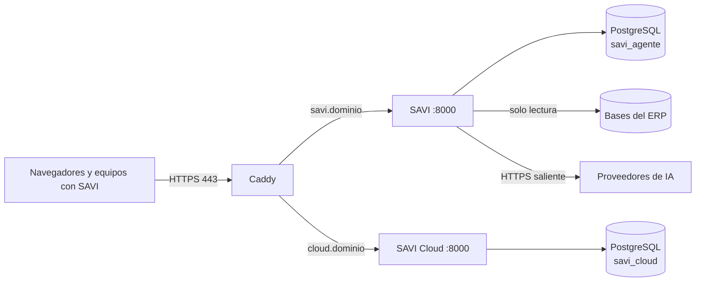

# Guía de despliegue y mantenimiento — SAVI Master

Documento de traspaso: con esto una persona que no participó puede operar, migrar y diagnosticar
el servicio. Comandos desde `deploy/master/`.

## 1. Arquitectura



| Servicio | Imagen | Puertos | Límites | Healthcheck |
|---|---|---|---|---|
| `caddy` | `caddy:${CADDY_VERSION}` | **80, 443, 443/udp** (único que publica) | 1 CPU / 256 MB | API de administración local |
| `savi` | `savi-master/savi:${SAVI_VERSION}` (se construye) | Ninguno (interno `8000`) | 2 CPU / 3 GB | `GET /health` |
| `cloud` | `savi-master/cloud:${SAVI_VERSION}` (se construye) | Ninguno (interno `8000`) | 1 CPU / 1 GB | `GET /health` |
| `db` | `postgres:${POSTGRES_VERSION}` | Ninguno | 2 CPU / 1 GB | `pg_isready` |

- **Redes:** `savi-master-edge` (Caddy, SAVI y Cloud, con salida a internet) y
  `savi-master-backend` (**interna**, sin salida: PostgreSQL vive solo ahí).
- **Volúmenes (bind mounts):** `data/postgres`, `data/caddy/{data,config}`, `data/savi/{data,home}`.
- **Un solo worker** de SAVI, a propósito: el registro de conexiones al ERP, el índice de
  documentos y los límites de pedidos viven en la memoria del proceso.
- **Logs:** `json-file` con rotación (3 × 10 MB). Ver con `docker compose logs -f <servicio>`.

## 2. Estructura del repositorio

Ver el mapa de archivos en [`README.md`](README.md).

## 3. Configuración

### Variables de `.env`

| Variable | Valor | Notas |
|---|---|---|
| `SAVI_DOMAIN`, `CLOUD_DOMAIN` | Dominios públicos | Registros DNS tipo A al servidor |
| `ACME_EMAIL` | Correo | Avisos de vencimiento de Let's Encrypt |
| `POSTGRES_VERSION`, `CADDY_VERSION` | Tags fijos | Verificar la última estable antes de cambiar |
| `TZ` | `America/Bogota` | |
| `SAVI_DB_USER/NAME`, `CLOUD_DB_USER/NAME` | Nombres | Cada app tiene su propio rol y base |
| `SAVI_ADMIN_LOGINS` | Códigos separados por coma | Administradores de SAVI además de los del ERP |
| `SAVI_MFA_ENFORCEMENT` | `admins` / `all` / `off` | Segundo factor (TOTP). Ver §5 |
| `SAVI_MFA_ISSUER` | Texto | Nombre que muestra la aplicación de autenticación |
| `SAVI_CLOUD_URL` | `https://<CLOUD_DOMAIN>` | Opcional: vincula este SAVI con el Cloud del servidor |
| `CLOUD_LATEST_VERSION[_PUBLISHED_AT]` | Versión y fecha | Habilita la alerta de instancias desactualizadas |
| `SAVI_VERSION/COMMIT/BUILT_AT` | **Generadas** | `setup.sh` las escribe desde el tag de git |

### Archivos de secretos (`secrets/*.txt`)

| Archivo | Para qué | Cómo se genera |
|---|---|---|
| `db_root_password` | Superusuario de PostgreSQL | `setup.sh`, 48 alfanuméricos |
| `savi_db_password` | Rol de SAVI | `setup.sh`, 48 alfanuméricos |
| `cloud_db_password` | Rol de Cloud | `setup.sh`, 48 alfanuméricos |
| `jwt_secret` | Firma de sesiones de SAVI | `setup.sh`, 64 alfanuméricos |
| `cloud_console_secret` | Sesiones de la consola y cifrado de TOTP | `setup.sh`, 64 alfanuméricos |
| `erp_credentials_key` | Cifra las contraseñas de las bases del ERP | `setup.sh`, clave Fernet |

> **`erp_credentials_key` no se rota a la ligera.** Perderla deja ilegibles todas las
> contraseñas de bases del ERP guardadas (hay que cargarlas de nuevo). Va en cada respaldo.
> **`cloud_console_secret`:** si se pierde, hay que restablecer el TOTP de todo el equipo.

Las claves de los proveedores de IA **no** son archivos: se cargan desde la administración de
SAVI y se guardan cifradas en la base.

## 4. Despliegue nuevo o migración

1. **DNS:** crear los registros `A` de `SAVI_DOMAIN` y `CLOUD_DOMAIN` hacia la IP del servidor y
   esperar la propagación (`dig +short <dominio>`). Let's Encrypt falla si no resuelven.
2. **Firewall del servidor:** permitir 80/tcp, 443/tcp y 443/udp. Nada más hacia afuera de la
   máquina (la base y las apps no publican puertos).
3. `git clone`, `./setup.sh`, editar `.env`, `./setup.sh`, `docker compose up -d --build`.
4. **Primer administrador de Cloud:** ver el [README](README.md#inicio-rápido).
5. **Primer administrador de SAVI:** entrar a `https://<SAVI_DOMAIN>` con un usuario del ERP
   incluido en `SAVI_ADMIN_LOGINS` (o administrador del ERP) y registrar las bases del ERP en
   Administración → Bases. Cargar la clave de IA en Administración → Proveedores de IA.
6. **Verificación:**
   - `curl -sI https://<SAVI_DOMAIN>/health` responde `200` con certificado válido.
   - `https://<SAVI_DOMAIN>/docs` responde `404` (la documentación del API no se publica).
   - `docker inspect savi-master-savi --format '{{json .Config.Env}}'` no muestra secretos.

**Migrar a otro servidor:** instalar en el nuevo, detener `savi` y `cloud` en el viejo, copiar
`backups/` (con `.env` y `secrets/` de esa copia) y restaurar con `rollback.sh` o con los
comandos de [`ACTUALIZACION.md`](ACTUALIZACION.md#4-reversa). Cambiar el DNS al final.

## 5. Operación

```bash
docker compose ps                         # estado y salud
docker compose logs -f --tail=100 savi    # logs de SAVI
docker compose restart savi               # reinicio ordenado
docker compose up -d --build              # aplicar cambios del repositorio
./backup.sh                               # respaldo etiquetado con la fecha
```

- **Cambiar un secreto:** editar el archivo y `docker compose up -d --force-recreate <servicio>`.
  Un reinicio simple no recarga los secretos. La contraseña de una base **ya inicializada** no
  cambia al editar su archivo: hay que cambiarla también en PostgreSQL (`ALTER ROLE`).
- **Respaldo diario (cron del servidor):**
  `0 3 * * * cd /ruta/savi/deploy/master && ./backup.sh >> backups/backup.log 2>&1`
  y copiar `backups/` **fuera del servidor**. Conservar al menos 7 días.
- **Espacio en disco:** `data/postgres`, los respaldos y, con el uso, `data/savi/home` (el CLI de
  Claude guarda sesiones). `docker system df` y `docker image prune` tras actualizar.
- **Segundo factor (TOTP) de los administradores de SAVI.** Con `SAVI_MFA_ENFORCEMENT=admins`,
  quien administra SAVI escribe usuario y contraseña (la del ERP) y después un código de 6
  dígitos de su aplicación. En el primer ingreso ve un QR (y la clave para cargar a mano) y
  confirma con el primer código. El secreto se guarda cifrado con `erp_credentials_key`.
  - **Perdió el celular:** otro administrador entra a Administración → Seguridad y lo
    restablece (cierra sus sesiones; configura de nuevo en el próximo ingreso).
  - **No queda ningún administrador que pueda entrar** (salida de emergencia, en el servidor):
    `docker compose exec savi /app/docker-entrypoint.sh python -m app.mfa_cli reset USUARIO@CLIENTE`
  - Si cambia `erp_credentials_key`, los secretos del segundo factor quedan ilegibles y esas
    cuentas piden un restablecimiento (no se degradan a «configurar de nuevo»: eso permitiría
    saltear el factor con solo la contraseña).
- **Flujo de cambios:** `git pull` + `./setup.sh` + `docker compose up -d --build`. No se copian
  archivos sueltos al servidor.

## 6. Integraciones

- **Instalaciones de SAVI en equipos** (modo escritorio): se vinculan a `https://<CLOUD_DOMAIN>` con
  un token que genera la consola. Aparecen en Instancias.
- **Bases del ERP:** SAVI se conecta desde este servidor, en solo lectura. El servidor necesita
  alcance de red a cada base (VPN o regla de firewall del lado del ERP).
- **Proveedores de IA:** salida HTTPS a Anthropic, Google y OpenAI.

## 7. Estándar de monitoreo

| Qué | Cómo |
|---|---|
| Disponibilidad | `GET https://<SAVI_DOMAIN>/health` y `https://<CLOUD_DOMAIN>/health` desde un monitor externo |
| Salud de los contenedores | `docker compose ps` (todos `healthy`) |
| Vencimiento del certificado | Caddy renueva solo; verificar los logs de `caddy` ante errores ACME |
| Instancias | Consola de Cloud → Alertas (instancia sin conexión, huella, errores) |

## 8. Lista de seguridad

- [ ] `.env`, `secrets/`, `backups/` con permisos `600`/`700` y fuera de git.
- [ ] Solo 80 y 443 publicados; la base no tiene puerto publicado.
- [ ] La documentación del API (`/docs`) responde 404.
- [ ] Administradores de Cloud y de SAVI con TOTP activo (`SAVI_MFA_ENFORCEMENT=admins`).
- [ ] Respaldos copiados fuera del servidor y restauración probada.
- [ ] Servidor con actualizaciones de seguridad del sistema operativo.
- [ ] SSH solo con llaves; sin acceso root por contraseña.

## 9. Pendientes

- Códigos de recuperación de un solo uso para el segundo factor (hoy se restablece por un
  administrador o por línea de comandos).
- `read_only` para el contenedor de SAVI (requiere probar el CLI de Claude bajo carga).
- Respaldo automático programado desde el propio compose y envío fuera del servidor.
- Prueba de restauración periódica automatizada.

## 10. Diagnóstico

| Síntoma | Causa probable | Acción |
|---|---|---|
| Caddy no emite el certificado | DNS sin propagar o puerto 80 cerrado | `dig +short <dominio>`; abrir 80/443; `docker compose logs caddy` |
| `savi` queda `unhealthy` | Falta un secreto o la base no responde | `docker compose logs savi` (el mensaje nombra el secreto) |
| `cloud` no arranca | Migración fallida | `docker compose logs cloud`; revisar `CLOUD_DB_*` |
| «Falta ERP_CREDENTIALS_KEY…» | Secreto ausente o vacío | `./setup.sh`; revisar `secrets/` |
| El chat responde de golpe, sin streaming | Un proxy intermedio hace buffer | Verificar que no haya otro proxy delante de Caddy |
| 429 al iniciar sesión | Límite de intentos (por usuario o por IP) | Esperar el `Retry-After`; ver `RATE_LIMIT_*` |
| Una base del ERP «no responde» | Sin ruta de red desde el servidor | Probar desde `docker compose exec savi` con `python` |
| `Permission denied` en `data/savi` | Propiedad del directorio | `sudo chown -R 10001:10001 data/savi` |
